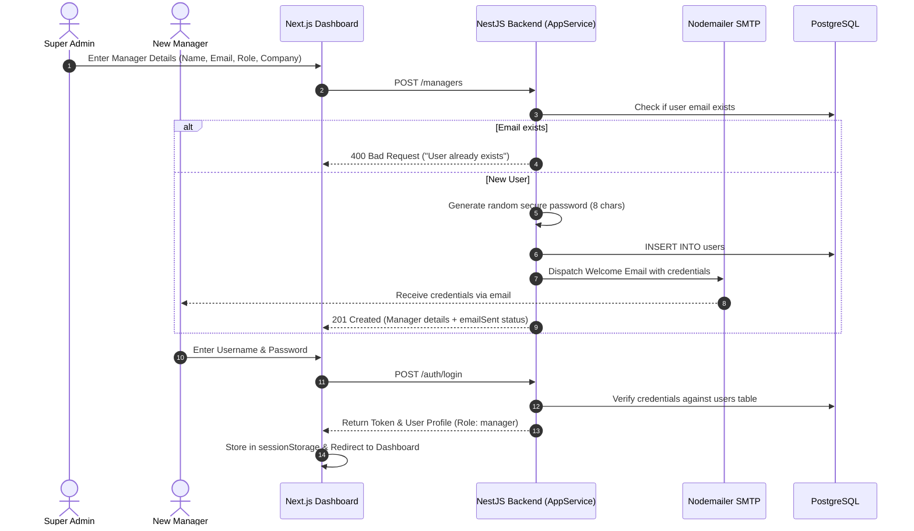
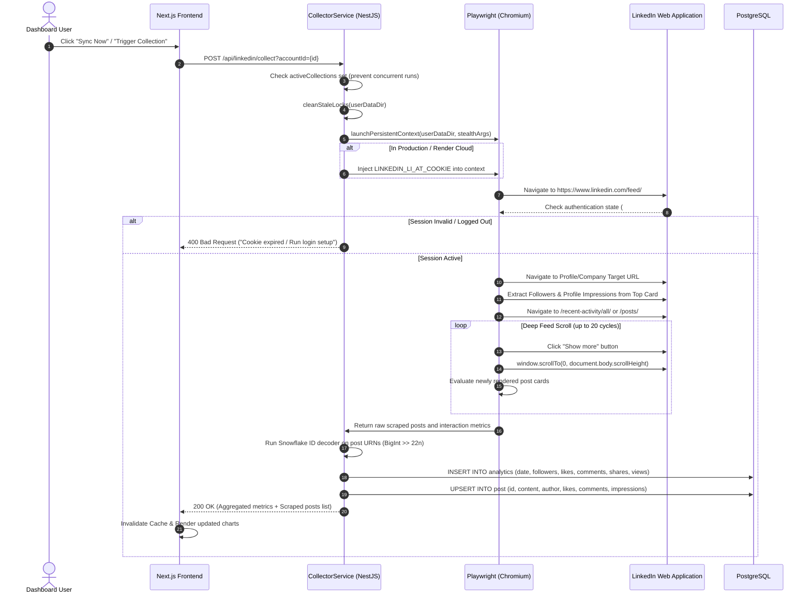
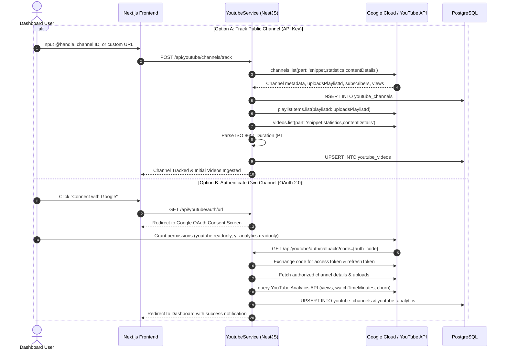
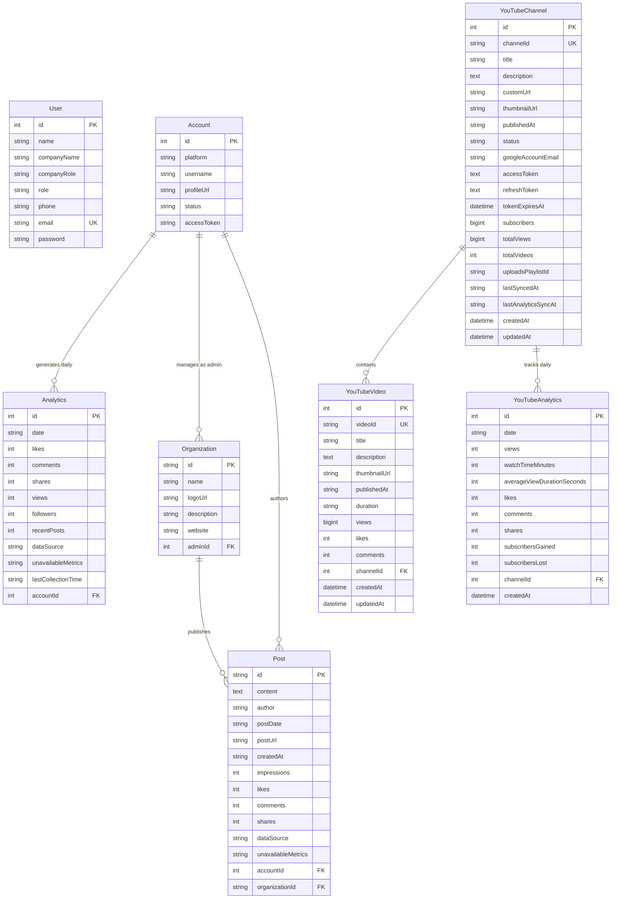

# Social Media Monitoring & Scraping Tool (`SocialPulse PRO`)
## Comprehensive System & Technical Documentation

---

# 1. INTRODUCTION

### 1.1 Project Overview & Background
The **Social Media Monitoring & Scraping Tool** (commercially branded as **SocialPulse PRO**) is a high-performance analytics, monitoring, and telemetry suite engineered to aggregate, process, normalize, and visualize cross-platform performance metrics across **LinkedIn** and **YouTube**.

In the contemporary digital marketing and enterprise brand management ecosystem, real-time social telemetry is indispensable. However, modern social media monitoring systems face two major bottlenecks:
1. **API Paywalls and Scope Restrictions**: Enterprise platforms such as LinkedIn restrict follower counts, profile impressions, and granular post-level interaction analytics to high-tier enterprise partner programs (such as the LinkedIn Community Management API or Marketing Developer Platform). For standard developers and mid-sized enterprises, default OAuth apps only grant basic user profile data (`openid`, `profile`, `email`), making public profile tracking and competitor monitoring impossible through standard APIs.
2. **Platform Fragmentation**: Ingesting telemetry across multiple channels requires handling radically different authentication paradigms, varying rate limits, and diverse data structures (e.g., YouTube's dual public API keys vs. OAuth Google Cloud studio access).

To address these challenges, this project implements a **Hybrid Telemetry Architecture**:
- **LinkedIn Telemetry Engine**: Employs an automated **Playwright headless Chromium browser scraping pipeline** equipped with cookie session persistence (`li_at`), anti-bot fingerprint masking, deep DOM feed traversal, and a mathematical 64-bit Snowflake timestamp extraction algorithm, paired with official LinkedIn OAuth 2.0 endpoints for authorized organization management.
- **YouTube Telemetry Engine**: Combines the **YouTube Data API v3** (for public channel tracking by handle/ID with zero login friction) and **Google OAuth 2.0 with the YouTube Analytics API** (for private studio analytics including watch time, average view duration, and subscriber churn).
- **Presentation & Management Layer**: A **Next.js (App Router)** responsive dashboard featuring an in-memory 0ms hydration cache, dark/light theme switching, role-based access control (Super Admin vs. Manager), automated SMTP email onboarding, report exporting (CSV and executive printable summaries), and multi-channel side-by-side comparative benchmarking.

### 1.2 Core Objectives and Scope
- **Automated Multi-Source Extraction**: Collect impressions, followers, reactions, comments, reposts, video views, watch time, and subscriber dynamics without manual intervention.
- **Resilient Headless Execution**: Execute headless browser automation seamlessly across both local development environments and containerized cloud hosts (e.g., Render/Linux) with automated browser binary detection and stale lock cleanup.
- **Sub-Second Dashboard Telemetry**: Deliver instantaneous (0ms frame-1) client-side tab switching using an SSR-safe in-memory cache synchronized with browser session storage.
- **Role-Based Security**: Isolate administrative capabilities (manager creation, global account deletion) to Super Admins while allowing Managers to monitor assigned brand footprints.
- **Auditable Reporting**: Export granular CSV datasets and structured executive reports for offline business analysis.

### 1.3 Complete Technology Stack

| Layer | Technology | Version / Specification | Role in Architecture |
| :--- | :--- | :--- | :--- |
| **Backend Framework** | NestJS | `v11.0.1` | Modular server architecture, controllers, dependency injection, and REST API routing |
| **Runtime Environment** | Node.js | `v20.x` LTS | High-performance asynchronous execution environment |
| **Programming Language** | TypeScript | `v5.7.3` | Strongly-typed enterprise development across frontend and backend |
| **Database ORM** | TypeORM | `v1.1.0` | Object-Relational Mapping, entity definitions, schema synchronization |
| **Relational Database** | PostgreSQL | `v15 / v16` (`pg v8.22`) | Persistent transactional relational storage for telemetry and accounts |
| **Browser Automation** | Playwright (Chromium) | `v1.62.1` | Headless DOM parsing, session cookie injection, infinite scroll feed scraping |
| **Cloud Google APIs** | `googleapis` | `v178.0.0` | Official client for YouTube Data API v3 and YouTube Analytics API |
| **Email Transport** | Nodemailer | `v9.0.4` | Automated SMTP email delivery with multi-port fallback (465/587) |
| **HTTP Client** | Axios | `v1.19.0` | LinkedIn REST API calls, OAuth token exchange, and external requests |
| **Frontend Framework** | Next.js | `v14+` (App Router) | Server-side rendering (SSR), static optimization, layout route grouping |
| **Frontend UI & Icons** | Tailwind CSS / Lucide React | Modern Design System | Sleek dark/light aesthetic, responsive grid system, glassmorphism UI |
| **Data Visualization** | Recharts | `v2.x` | Interactive Area charts, Bar charts, and multi-series line comparisons |

---

# 2. SYSTEM DESIGN

### 2.1 Architectural Paradigm
The system adheres to a **3-Tier Service-Oriented Architecture (SOA)** with decoupled Client, Application, and Persistence layers. Communication is facilitated over asynchronous JSON REST APIs.

```
+---------------------------------------------------------------------------------------+
|                                  PRESENTATION LAYER                                   |
|                      (Next.js App Router, React 18, Tailwind CSS)                     |
|                                                                                       |
|  [ Auth / Login ]  [ Overview ]  [ LinkedIn Hub ]  [ YouTube Hub ]  [ Reports / CSV ] |
|         |                 |              |               |                 |          |
|  +---------------------------------------------------------------------------------+  |
|  |       Client Telemetry Cache (RAM Map + SessionStorage Pub/Sub Store)           |  |
|  +---------------------------------------------------------------------------------+  |
+-------------------------------------------+-------------------------------------------+
                                            | HTTPS / JSON REST
+-------------------------------------------v-------------------------------------------+
|                               APPLICATION LOGIC LAYER                                 |
|                         (NestJS Server on Express Platform)                           |
|                                                                                       |
|  +-------------------+  +-------------------+  +-----------------------------------+  |
|  |   AppController   |  |LinkedinController |  |        YoutubeController          |  |
|  |    AppService     |  |  LinkedinService  |  |          YoutubeService           |  |
|  | - Auth & RBAC     |  | - OAuth2 REST     |  | - Channel Track (Data API v3)     |  |
|  | - User Management |  | - Org Management  |  | - OAuth2 Flow & Token Exchange    |  |
|  | - SMTP Mailer     |  | - Rest Acls & Stat|  | - Analytics API (Watch Time)      |  |
|  +-------------------+  +-------------------+  | - Video Duration & Stats Sync     |  |
|                                                | - Comparison Engine               |  |
|  +------------------------------------------+  +-----------------------------------+  |
|  |            CollectorController           |                                         |
|  |             CollectorService             |                                         |
|  | - Persistent Playwright Chromium Context |                                         |
|  | - Anti-Bot Stealth Evasions              |                                         |
|  | - Snowflake ID Timestamp Extraction      |                                         |
|  | - Dynamic Feed Scroll & Post Extraction  |                                         |
|  +------------------------------------------+                                         |
+---------------------+---------------------------------------------------+-------------+
                      |                                                   |
                      | TypeORM Engine                                    | HTTP / Scraping
+---------------------v-----------------------+   +-----------------------v-------------+
|              DATA STORAGE LAYER             |   |         EXTERNAL PLATFORMS          |
|                 (PostgreSQL)                |   |                                     |
|                                             |   |  - LinkedIn Web (li_at session)     |
|  - users              - account             |   |  - LinkedIn API (api.linkedin.com)  |
|  - organization       - analytics           |   |  - Google Cloud OAuth 2.0           |
|  - post               - youtube_channels    |   |  - YouTube Data API v3              |
|  - youtube_videos     - youtube_analytics   |   |  - YouTube Analytics API            |
+---------------------------------------------+   |  - SMTP Host (Gmail / Port 465/587) |
                                                  +-------------------------------------+
```

### 2.2 Key Architectural Patterns

1. **Hybrid Ingestion Pattern**:
   - When official REST APIs are restricted or prohibitively expensive (e.g., LinkedIn public follower counts and individual post views without enterprise API tier), the system gracefully routes requests to the **Playwright Scraping Engine**.
   - When official APIs offer complete and high-resolution access (e.g., YouTube Data API v3 and YouTube Analytics API), the system uses the official Google Cloud SDK.

2. **Snowflake Timestamp Extraction Algorithm**:
   - LinkedIn activity URNs (`urn:li:activity:7182938491823910293`) embed creation timestamps using Twitter-style 64-bit Snowflake IDs.
   - The backend decodes the 64-bit BigInt by shifting it right by 22 bits (`BigInt(activityId) >> 22n`) to compute exact millisecond Unix timestamps without relying on vague DOM relative strings like `"3w ago"`.

3. **Persistent Browser Context & Stale Lock Management**:
   - Playwright uses persistent user data directories (`.linkedin-browser-profile-{accountId}`).
   - Before launching Chromium, the `cleanStaleLocks()` routine removes orphaned lock files (`SingletonLock`, `SingletonCookie`, `SingletonSocket`, `lockfile`), preventing cloud server crashes when containers restart unexpectedly.

4. **Two-Tier Resilient Caching Architecture**:
   - **Backend RAM Cache**: Accounts and historical analytics cache (`accountsCache`) with invalidation hooks on account update or deletion.
   - **Frontend RAM + Storage Cache**: In-memory `Map` coupled with `sessionStorage` and event subscription listeners (`data-cache.ts`), providing 0ms frame-1 UI loading when switching between dashboard tabs.

5. **Multi-Strategy Resilient SMTP Delivery**:
   - `AppService.sendAccountEmail` implements a cascading fallback sequence:
     1. Custom Configured Host/Port (`EMAIL_HOST`, `EMAIL_PORT`, `EMAIL_SECURE`)
     2. Direct Gmail SSL (`smtp.gmail.com:465`)
     3. Direct Gmail STARTTLS (`smtp.gmail.com:587`)
     4. Nodemailer default service alias (`service: 'gmail'`)

---

# 3. WORK FLOW DIAGRAM

### 3.1 Authentication & User Management Workflow


### 3.2 LinkedIn Data Scraping & Ingestion Workflow


### 3.3 YouTube Data Synchronization & Analytics Pipeline


---

# 4. ER DIAGRAM



---

# 5. TABLE DESIGN

### 5.1 `users` Table
Stores administrative users and system managers who have credentials to log into the application dashboard.

| Column Name | PostgreSQL Type | TypeORM Mapping | Constraints | Nullable | Description |
| :--- | :--- | :--- | :--- | :--- | :--- |
| `id` | `INTEGER` | `number` | `PRIMARY KEY`, Auto Increment | `NO` | Unique internal system user ID |
| `name` | `VARCHAR` | `string` | - | `NO` | Full name of the user |
| `companyName` | `VARCHAR` | `string` | - | `NO` | Organization or enterprise the user represents |
| `companyRole` | `VARCHAR` | `string` | - | `YES` | Professional designation (e.g., Marketing Director) |
| `role` | `VARCHAR` | `string` | `DEFAULT 'user'` | `NO` | Permission tier: `super_admin` or `manager` |
| `phone` | `VARCHAR` | `string` | - | `NO` | Contact telephone number |
| `email` | `VARCHAR` | `string` | `UNIQUE` | `NO` | Login identifier and destination for SMTP notifications |
| `password` | `VARCHAR` | `string` | - | `NO` | Stored credentials for authentication |

### 5.2 `account` Table
Represents external social accounts (specifically LinkedIn profiles and company accounts) linked to the monitoring system.

| Column Name | PostgreSQL Type | TypeORM Mapping | Constraints | Nullable | Description |
| :--- | :--- | :--- | :--- | :--- | :--- |
| `id` | `INTEGER` | `number` | `PRIMARY KEY`, Auto Increment | `NO` | Unique linked account record ID |
| `platform` | `VARCHAR` | `string` | `DEFAULT 'LinkedIn'` | `NO` | Social platform identifier (`LinkedIn`, etc.) |
| `username` | `VARCHAR` | `string` | - | `NO` | Target handle, slug, or profile vanity username |
| `profileUrl` | `VARCHAR` | `string` | - | `NO` | Direct web URL to the profile or organization page |
| `status` | `VARCHAR` | `string` | `DEFAULT 'Connected'` | `NO` | Operational state: `Connected`, `Syncing`, `Error` |
| `accessToken` | `VARCHAR` | `string` | - | `YES` | OAuth 2.0 Bearer access token when connected via API |

### 5.3 `analytics` Table
Maintains daily time-series telemetry snapshots collected for each LinkedIn account.

| Column Name | PostgreSQL Type | TypeORM Mapping | Constraints | Nullable | Description |
| :--- | :--- | :--- | :--- | :--- | :--- |
| `id` | `INTEGER` | `number` | `PRIMARY KEY`, Auto Increment | `NO` | Unique analytics record identifier |
| `date` | `VARCHAR` | `string` | Format `YYYY-MM-DD` | `NO` | Metric date bucket |
| `likes` | `INTEGER` | `number` | `DEFAULT 0` | `NO` | Aggregate total post reactions detected |
| `comments` | `INTEGER` | `number` | `DEFAULT 0` | `NO` | Aggregate total post comments detected |
| `shares` | `INTEGER` | `number` | `DEFAULT 0` | `NO` | Aggregate total reposts/shares detected |
| `views` | `INTEGER` | `number` | `DEFAULT 0` | `NO` | Aggregate post impressions or profile views |
| `followers` | `INTEGER` | `number` | `DEFAULT 0` | `NO` | Total follower count extracted from target page |
| `recentPosts` | `INTEGER` | `number` | `DEFAULT 0` | `NO` | Number of posts actively evaluated in this collection |
| `dataSource` | `VARCHAR` | `string` | `DEFAULT 'API'` | `NO` | Origin of data: `Scraper` or `API` |
| `unavailableMetrics` | `VARCHAR` | `string` | - | `YES` | Comma-separated list of metrics blocked by platform |
| `lastCollectionTime` | `VARCHAR` | `string` | ISO 8601 String | `YES` | Exact timestamp of the collection run |
| `accountId` | `INTEGER` | `number` | `FOREIGN KEY (account.id)` | `YES` | Relational reference to parent account |

### 5.4 `organization` Table
Stores LinkedIn Company / Organization entities administered by an authenticated account.

| Column Name | PostgreSQL Type | TypeORM Mapping | Constraints | Nullable | Description |
| :--- | :--- | :--- | :--- | :--- | :--- |
| `id` | `VARCHAR` | `string` | `PRIMARY KEY` (e.g. URN or ID) | `NO` | LinkedIn organization URN or numeric ID |
| `name` | `VARCHAR` | `string` | - | `NO` | Name of the organization page |
| `logoUrl` | `VARCHAR` | `string` | - | `YES` | URL to the corporate logo graphic |
| `description` | `VARCHAR` | `string` | - | `YES` | Corporate overview text |
| `website` | `VARCHAR` | `string` | - | `YES` | Company official website link |
| `adminId` | `INTEGER` | `number` | `FOREIGN KEY (account.id)` | `YES` | Admin account owning management rights |

### 5.5 `post` Table
Stores scraped and synchronized individual social media feed posts.

| Column Name | PostgreSQL Type | TypeORM Mapping | Constraints | Nullable | Description |
| :--- | :--- | :--- | :--- | :--- | :--- |
| `id` | `VARCHAR` | `string` | `PRIMARY KEY` (e.g., URN) | `NO` | Unique platform activity ID (`urn:li:activity:...`) |
| `content` | `TEXT` | `string` | - | `NO` | Text body of the post |
| `author` | `VARCHAR` | `string` | - | `YES` | Cleaned author name or company page title |
| `postDate` | `VARCHAR` | `string` | - | `YES` | Human-readable relative date (e.g. "3 days ago") |
| `postUrl` | `VARCHAR` | `string` | - | `YES` | Permanent link directly to the post update |
| `createdAt` | `VARCHAR` | `string` | ISO 8601 String | `NO` | Exact timestamp calculated via Snowflake decoder |
| `impressions` | `INTEGER` | `number` | `DEFAULT 0` | `NO` | Scraped views or impressions count |
| `likes` | `INTEGER` | `number` | `DEFAULT 0` | `NO` | Total likes / reactions |
| `comments` | `INTEGER` | `number` | `DEFAULT 0` | `NO` | Total comments |
| `shares` | `INTEGER` | `number` | `DEFAULT 0` | `NO` | Total reposts |
| `dataSource` | `VARCHAR` | `string` | `DEFAULT 'API'` | `NO` | Provenance: `Scraper` or `API` |
| `unavailableMetrics` | `VARCHAR` | `string` | - | `YES` | Unreachable metric indicators |
| `accountId` | `INTEGER` | `number` | `FOREIGN KEY (account.id)` | `YES` | Cascading foreign key to `account` |
| `organizationId` | `VARCHAR` | `string` | `FOREIGN KEY (organization.id)`| `YES` | Optional foreign key to `organization` |

### 5.6 `youtube_channels` Table
Stores all tracked and OAuth-authenticated YouTube channels.

| Column Name | PostgreSQL Type | TypeORM Mapping | Constraints | Nullable | Description |
| :--- | :--- | :--- | :--- | :--- | :--- |
| `id` | `INTEGER` | `number` | `PRIMARY KEY`, Auto Increment | `NO` | Internal channel record ID |
| `channelId` | `VARCHAR` | `string` | `UNIQUE` | `NO` | YouTube channel ID (24 chars, starts with `UC`) |
| `title` | `VARCHAR` | `string` | - | `NO` | Official title of the YouTube channel |
| `description` | `TEXT` | `string` | - | `YES` | Channel bio description |
| `customUrl` | `VARCHAR` | `string` | - | `YES` | Channel handle (e.g. `@google`) |
| `thumbnailUrl` | `VARCHAR` | `string` | - | `YES` | High-res channel avatar URL |
| `publishedAt` | `VARCHAR` | `string` | ISO 8601 String | `YES` | Channel registration timestamp |
| `status` | `VARCHAR` | `string` | `DEFAULT 'Connected'` | `NO` | Connection status |
| `googleAccountEmail`| `VARCHAR` | `string` | - | `YES` | Authenticated Google email address |
| `accessToken` | `TEXT` | `string` | - | `YES` | OAuth 2.0 Access Token for Studio Analytics |
| `refreshToken`| `TEXT` | `string` | - | `YES` | Refresh Token for offline token rotation |
| `tokenExpiresAt`| `TIMESTAMP` | `Date` | - | `YES` | Token expiration timestamp |
| `subscribers` | `BIGINT` | `number` | `DEFAULT 0` | `NO` | Lifetime subscriber count |
| `totalViews` | `BIGINT` | `string` | `DEFAULT 0` | `NO` | Lifetime public view count |
| `totalVideos` | `INTEGER` | `number` | `DEFAULT 0` | `NO` | Total public published video count |
| `uploadsPlaylistId`| `VARCHAR` | `string` | - | `YES` | Associated Uploads playlist ID (`UU...`) |
| `lastSyncedAt`| `VARCHAR` | `string` | - | `YES` | Timestamp of last video/meta sync |
| `lastAnalyticsSyncAt`| `VARCHAR`| `string` | - | `YES` | Timestamp of last daily analytics sync |
| `createdAt` | `TIMESTAMP` | `Date` | Automatic timestamp | `NO` | Record creation date |
| `updatedAt` | `TIMESTAMP` | `Date` | Automatic timestamp | `NO` | Record modification date |

### 5.7 `youtube_videos` Table
Contains video metadata and engagement counters belonging to tracked YouTube channels.

| Column Name | PostgreSQL Type | TypeORM Mapping | Constraints | Nullable | Description |
| :--- | :--- | :--- | :--- | :--- | :--- |
| `id` | `INTEGER` | `number` | `PRIMARY KEY`, Auto Increment | `NO` | Internal video record ID |
| `videoId` | `VARCHAR` | `string` | `UNIQUE` (11 chars) | `NO` | YouTube standard Video ID |
| `title` | `VARCHAR` | `string` | - | `NO` | Video title |
| `description` | `TEXT` | `string` | - | `YES` | Video description |
| `thumbnailUrl` | `VARCHAR` | `string` | - | `YES` | High-resolution thumbnail image URL |
| `publishedAt` | `VARCHAR` | `string` | ISO 8601 String | `NO` | Upload publication timestamp |
| `duration` | `VARCHAR` | `string` | `DEFAULT '00:00'` | `NO` | Parsed duration in `HH:MM:SS` or `MM:SS` format |
| `views` | `BIGINT` | `number` | `DEFAULT 0` | `NO` | Current view counter |
| `likes` | `INTEGER` | `number` | `DEFAULT 0` | `NO` | Current likes counter |
| `comments` | `INTEGER` | `number` | `DEFAULT 0` | `NO` | Current comment counter |
| `channelId` | `INTEGER` | `number` | `FOREIGN KEY (youtube_channels.id)` | `YES` | Cascading foreign key to channel |
| `createdAt` | `TIMESTAMP` | `Date` | Automatic timestamp | `NO` | Record creation date |
| `updatedAt` | `TIMESTAMP` | `Date` | Automatic timestamp | `NO` | Record update date |

### 5.8 `youtube_analytics` Table
Stores daily performance time-series records fetched from the YouTube Analytics API.

| Column Name | PostgreSQL Type | TypeORM Mapping | Constraints | Nullable | Description |
| :--- | :--- | :--- | :--- | :--- | :--- |
| `id` | `INTEGER` | `number` | `PRIMARY KEY`, Auto Increment | `NO` | Unique analytics ID |
| `date` | `VARCHAR` | `string` | Format `YYYY-MM-DD` | `NO` | Daily report date |
| `views` | `INTEGER` | `number` | `DEFAULT 0` | `NO` | Views accumulated on that day |
| `watchTimeMinutes`| `INTEGER` | `number` | `DEFAULT 0` | `NO` | Estimated watch time in minutes |
| `averageViewDurationSeconds` | `INTEGER` | `number` | `DEFAULT 0` | `NO` | Average view duration in seconds |
| `likes` | `INTEGER` | `number` | `DEFAULT 0` | `NO` | Likes received on that day |
| `comments` | `INTEGER` | `number` | `DEFAULT 0` | `NO` | Comments posted on that day |
| `shares` | `INTEGER` | `number` | `DEFAULT 0` | `NO` | Shares registered on that day |
| `subscribersGained`| `INTEGER`| `number` | `DEFAULT 0` | `NO` | New subscribers joined |
| `subscribersLost` | `INTEGER` | `number` | `DEFAULT 0` | `NO` | Subscribers unsubscribed (churn) |
| `channelId` | `INTEGER` | `number` | `FOREIGN KEY (youtube_channels.id)` | `NO` | Relational channel key |
| `createdAt` | `TIMESTAMP` | `Date` | Automatic timestamp | `NO` | Creation timestamp |

---

# 6. MODULE DESIGN (A TO Z ARCHITECTURE DEEP DIVE)

### Module A: Authentication, RBAC & User Administration
- **Files**: 
  - `user.entity.ts`
  - `app.controller.ts`
  - `app.service.ts`
  - `frontend/src/app/page.tsx`
  - `frontend/src/app/dashboard/users/page.tsx`
  - `frontend/src/app/dashboard/users/add/page.tsx`

#### 1. Functionality & Business Logic
The system implements Role-Based Access Control (RBAC) supporting two distinct roles:
1. `super_admin`: Has full privileges, including adding and deleting system managers, removing connected accounts, reconfiguring API credentials, and viewing diagnostic logs.
2. `manager`: Has standard dashboard privileges, allowing performance monitoring, report generation, and channel tracking without access to administrative user management.

#### 2. Key Methods & Implementations
- `AppService.login(body)`:
  - Supports a built-in bootstrap Super Admin credential path (`admin` / `admin123`) for initial deployment and emergency access.
  - Queries the PostgreSQL `users` table using case-insensitive matchers (`ILike(username)` on `email` and `name`).
  - Returns authenticated session payloads containing access tokens, role designations, and company context.
- `AppService.createManager(data)`:
  - Validates uniqueness of user emails.
  - Generates a cryptographically randomized 8-character temporary password (`Math.random().toString(36).slice(-8)`).
  - Persists the new user in the database.
  - Triggers asynchronous welcome email dispatch with credentials via the SMTP subsystem.
- `AppService.changePassword(body)`:
  - Validates the current password and securely updates the stored password for either the super admin or a manager account.

---

### Module B: Resilient SMTP Dispatch & Email Engine
- **Files**:
  - `app.service.ts` (`sendAccountEmail`, `verifySmtp`)
  - `app.controller.ts`

#### 1. Functionality & Business Logic
When a Super Admin invites a new brand manager to the platform, the system sends an HTML email containing their workspace login URL, assigned role, username, and temporary password.

#### 2. Multi-Transport Resilience
Standard cloud environments (such as Render, Heroku, or AWS EC2) frequently block or throttle outbound SMTP traffic on default ports. To ensure reliable email delivery:
- `AppService.sendAccountEmail`:
  - Configures an array of candidate transports:
    1. Custom SMTP host configuration (if `EMAIL_HOST` is supplied) with STARTTLS.
    2. Direct Google SMTP via SSL Port 465 (`smtp.gmail.com:465`).
    3. Direct Google SMTP via STARTTLS Port 587 (`smtp.gmail.com:587`).
    4. Nodemailer built-in `service: 'gmail'` transport.
  - Sequentially iterates through the transports; if attempt $N$ encounters a network timeout or reset, attempt $N+1$ executes immediately.
- `AppService.verifySmtp()`:
  - Diagnostic endpoint (`GET /email/verify`) that executes `transporter.verify()` against configured credentials, returning structured JSON indicating whether SMTP configuration is healthy or reporting exact error codes (`EAUTH`, `ETIMEDOUT`).

---

### Module C: LinkedIn Account & REST Management
- **Files**:
  - `account.entity.ts`
  - `organization.entity.ts`
  - `linkedin.controller.ts`
  - `linkedin.service.ts`

#### 1. Functionality & Business Logic
Handles connected LinkedIn profiles, organization associations, and official LinkedIn OAuth 2.0 REST API calls.

#### 2. Endpoints & Integrations
- `GET /auth/linkedin`: Initiates the OAuth 2.0 authorization code flow with requested scopes (`openid profile email`).
- `GET /auth/linkedin/callback`: Exchanges the authorization code for a Bearer token via `https://www.linkedin.com/oauth/v2/accessToken`, queries `https://api.linkedin.com/v2/userinfo`, and creates or updates the associated `Account`.
- `GET /api/linkedin/organizations`: Dispatches requests to LinkedIn Rest API (`/rest/organizationAcls`) with header `LinkedIn-Version: 202401` to retrieve organization URNs where the authenticated user holds administrative rights.
- `GET /api/linkedin/company/:orgId`: Retrieves organizational metadata and profile URLs.
- `GET /api/linkedin/company/:orgId/followers` & `page-statistics`: Interfaces with `/rest/organizationalEntityFollowerStatistics` for accounts with approved Community Management API access.

---

### Module D: LinkedIn Headless Scraping & Telemetry Engine
- **Files**:
  - `collector.controller.ts`
  - `collector.service.ts`
  - `install-browsers.js`
  - `post.entity.ts`
  - `analytics.entity.ts`

#### 1. Functionality & Business Logic
The core scraping engine of the application. When a brand connects a LinkedIn handle or triggers a data refresh, this module spins up a headless Chromium browser instance to extract live followers, impressions, and individual post telemetry without requiring expensive LinkedIn enterprise API licenses.

#### 2. Detailed Technical Capabilities

##### A. Dynamic Browser Discovery & Self-Healing
On cloud platforms like Render, Chromium binaries are not stored in standard local paths. 
- `findChromiumExecutable()` checks custom directories (`node_modules/playwright-core/.local-browsers`, `/opt/render/.cache/ms-playwright`, `~/.cache/ms-playwright`, `/usr/bin/chromium`).
- `ensureChromiumExecutable()`: If no valid binary is found, automatically triggers `npx playwright install chromium` with `PLAYWRIGHT_BROWSERS_PATH=0` in child process mode.
- `cleanStaleLocks()`: Cleans lingering lock files (`SingletonLock`, etc.) to prevent browser launch crashes.

##### B. Anti-Bot Stealth Architecture
Chromium is launched with a hardened profile:
- Args: `--disable-blink-features=AutomationControlled`, `--no-sandbox`, `--disable-dev-shm-usage`, realistic Windows User-Agent string.
- Page initialization script:
  ```typescript
  await context.addInitScript(() => {
    Object.defineProperty(navigator, 'webdriver', { get: () => undefined });
  });
  ```
- Cookie injection: In cloud/production environments, injects the `LINKEDIN_LI_AT_COOKIE` directly into `.linkedin.com` domain context.

##### C. Resilient Follower Metric Extraction (`extractFollowers`)
Because LinkedIn updates its DOM classes regularly, the follower parser utilizes multi-level regex parsing combined with strict semantic exclusion:
1. Regex matching handles formats like `12.5k followers`, `1,240 followers`, `500+ connections`.
2. Inspects `<section>` blocks containing `Activity`.
3. Checks Top Card selectors (`.pv-top-card`, `.org-top-card-summary__follower-count`, `a[href*="/followers/"]`).
4. Traverses DOM parents to exclude unrelated elements containing strings like `trending news`, `people also follow`, or `connections follow this page`.

##### D. Snowflake ID Timestamp Extraction
LinkedIn post URLs contain an internal Snowflake ID. Instead of relying on ambiguous relative dates from the DOM (such as "2w ago"), the service extracts the 64-bit integer from the activity URN:
```typescript
const activityId = BigInt(match[1]);
const timestampMs = Number(activityId >> BigInt(22));
const dateObj = new Date(timestampMs);
```
This calculation extracts the exact millisecond-precision creation timestamp directly from the first 42 bits of the ID.

##### E. Deep Feed Traversal Engine
The scraper navigates to the target's `/recent-activity/all/` or `/posts/` URL:
- Enters a scroll loop (up to 20 cycles).
- Automatically detects and clicks "Show more results" buttons.
- Scrolls the body height (`window.scrollTo(0, document.body.scrollHeight)`).
- Pauses for AJAX network hydration.
- Parses DOM cards to extract post text, reaction counts, comment counts, repost counts, and post impression counts.
- Upserts extracted posts into the `post` table and writes aggregated daily totals to the `analytics` table.

##### F. Paginated Post Query Engine (`getPosts`)
Provides high-performance filtering, full-text searching (`ILIKE` on post content or author), dynamic sorting (`impressions`, `likes`, `comments`, `shares`, `createdAt`), and pagination (`page`, `limit`).

---

### Module E: YouTube Data Ingestion & Analytics Engine
- **Files**:
  - `youtube-channel.entity.ts`
  - `youtube-video.entity.ts`
  - `youtube-analytics.entity.ts`
  - `youtube.controller.ts`
  - `youtube.service.ts`

#### 1. Functionality & Business Logic
Provides end-to-end telemetry for YouTube, supporting both public channel intelligence and private channel studio analytics.

#### 2. Detailed Technical Capabilities

##### A. Dual Ingestion Pipelines
- **Public Ingestion via YouTube Data API v3**:
  - Users can track any public creator or competitor by providing their handle (`@handle`), channel ID (`UC...`), or custom vanity URL.
  - Automatically queries `youtube.channels.list(forHandle: ...)` or `youtube.search.list`.
  - Resolves channel subscriber counts, lifetime views, and the associated uploads playlist ID (`uploadsPlaylistId` or by replacing `UC` with `UU`).
- **Private Ingestion via Google OAuth 2.0**:
  - Authenticates channel owners via Google Sign-In with scopes:
    - `https://www.googleapis.com/auth/youtube.readonly`
    - `https://www.googleapis.com/auth/yt-analytics.readonly`
    - `https://www.googleapis.com/auth/userinfo.email`
  - Acquires both access and refresh tokens, updating credentials automatically upon expiration.

##### B. Uploads Playlist Video Synchronization (`syncVideosWithApiKey`)
- Fetches all public videos via the uploads playlist using paginated calls to `youtube.playlistItems.list`.
- Batches video IDs (up to 50 per request) to fetch complete statistics and content details from `youtube.videos.list`.
- Implements custom ISO 8601 duration parsing (`parseDuration`) to convert durations (e.g., `PT1H23M45S` $\rightarrow$ `01:23:45`, `PT4M15S` $\rightarrow$ `04:15`).
- Upserts video entities with view counts, like counts, and comment tallies.

##### C. YouTube Analytics API Daily Synchronization (`syncAnalyticsWithOAuth`)
- Queries the Google Analytics reporting endpoint:
  ```typescript
  const res = await analytics.reports.query({
    ids: 'channel==MINE',
    startDate: startDateStr,
    endDate: endDateStr,
    metrics: 'views,estimatedMinutesWatched,averageViewDuration,likes,comments,shares,subscribersGained,subscribersLost',
    dimensions: 'day',
    sort: 'day',
  });
  ```
- Saves records into `youtube_analytics`, enabling daily tracking of watch time, average view duration, and subscriber growth/churn.

##### D. Multi-Channel Comparison Engine (`compareChannels`)
- Accepts multiple channel IDs (`?channelIds=1,2,3`).
- Aggregates lifetime benchmarks (subscribers, views, video library size) and period metrics across user-selected windows (`7d`, `30d`, `90d`, `1y`).
- Aligns daily time-series data for direct visualization on multi-line comparison charts.

##### E. Orphaned Video Auto-Repair (`repairOrphanedVideos`)
- Executes on module startup (`onModuleInit`).
- Detects video records missing channel associations in the database and re-links them automatically.

---

### Module F: Client-Side Telemetry Caching Engine
- **Files**:
  - `frontend/src/lib/data-cache.ts`
  - `frontend/src/lib/api-config.ts`

#### 1. Functionality & Business Logic
To eliminate layout shift and loading spinners when navigating between dashboard tabs, the frontend implements an in-memory caching and state synchronization system.

#### 2. Architecture & Methods
- **In-Memory RAM Store (`memoryCache`)**: Global `Map<string, CacheEntry>` providing instantaneous 0ms synchronous access within the current browser session.
- **Storage Promotion & Fallback**: Automatically promotes entries from `sessionStorage` into RAM.
- **SSR-Safe Hydration Guard (`getSSRSafeCache`)**:
  - In Next.js App Router, reading browser storage during the initial render can cause React hydration mismatches (Error 418/423).
  - `getSSRSafeCache` returns `null` on server-side render and initial hydration pass, then returns cached data on all subsequent client-side tab clicks once `markHydrated()` runs.
- **Event-Driven Pub/Sub Invalidation (`subscribeToCache`, `setInCache`, `invalidateCache`)**: Allows components to subscribe to cache keys, triggering real-time re-renders whenever fresh telemetry is written to the store.

---

### Module G: Frontend Dashboard Interfaces & User Experience
- **Files**:
  - `layout.tsx`
  - `dashboard/page.tsx`
  - `dashboard/[id]/page.tsx`
  - `dashboard/youtube/page.tsx`
  - `youtube-comparison-dashboard.tsx`
  - `dashboard/reports/page.tsx`
  - `dashboard/company/page.tsx`
  - `dashboard/profile/page.tsx`
  - `dashboard/settings/page.tsx`

#### 1. Page-by-Page Feature Matrix

| Dashboard Route | Primary Capabilities & UI Architecture |
| :--- | :--- |
| **`/dashboard`** | **LinkedIn Overview**: Shows connected accounts, aggregate follower counts, impressions, and likes. Includes modal to connect new handles and one-click data collection triggers. |
| **`/dashboard/[id]`** | **Detailed Account Analytics**: Time-series charts for impressions and engagement, post history table with search, sorting, and direct links to LinkedIn updates. |
| **`/dashboard/youtube`** | **YouTube Studio Hub**: Overview cards (subscribers, views, videos, watch time), date range filters (`7d`, `30d`, `90d`, `1y`), top video tables, and OAuth/API key setup. |
| **`/dashboard/youtube/compare`** | **Multi-Channel Comparison**: Side-by-side benchmarking of up to 3 channels with comparative Area/Bar charts and subscriber growth rates. |
| **`/dashboard/reports`** | **Export & Intelligence Center**: Generates CSV datasets and structured executive reports for offline analysis. |
| **`/dashboard/users`** | **Manager Administration (Admin Only)**: Displays team members, assigned brands, access privileges, and link to create new managers. |
| **`/dashboard/users/add`** | **User Provisioning**: Form to create managers, automatically generates temporary passwords and sends welcome emails via SMTP. |
| **`/dashboard/settings`** | **System & Account Settings**: Password updates, preference toggles (auto-sync, telemetry notifications), and theme switching. |
| **`/dashboard/company`** | **Company Page Hub**: Dedicated tracking for LinkedIn company pages managed by the authenticated account. |
| **`/dashboard/profile`** | **Workspace Profile**: Central hub showing connected channels across all platforms, account health badges, and navigation shortcuts. |

---

# 7. CONCLUSION

### 7.1 Summary of Technical Achievements
The **Social Media Monitoring & Scraping Tool (`SocialPulse PRO`)** provides a robust, production-ready solution to modern social media analytics and data access constraints:
1. **Solves Platform API Paywalls**: By coupling a headless **Playwright** browser automation pipeline with **Snowflake ID decoding**, the system extracts granular post-level impressions and follower metrics that normally require enterprise-tier LinkedIn licenses.
2. **Comprehensive YouTube Telemetry**: Combines public channel tracking via the **YouTube Data API v3** with authorized studio metrics (watch time, view duration, subscriber churn) via the **YouTube Analytics API**.
3. **Sub-Second Dashboard UX**: Leverages an **SSR-safe dual-tier cache** in Next.js, eliminating loading spinners during client-side tab switching.
4. **Production Resilience**: Includes automated browser binary detection, lockfile cleanup, and cascading SMTP email fallbacks, ensuring stability across local and cloud environments (e.g., Render).
5. **Enterprise Management**: Built-in Role-Based Access Control isolates administrative management from everyday brand monitoring.

### 7.2 System Extensibility
The modular architecture makes it straightforward to add new platforms in future iterations:
- **Additional Networks**: The entity and controller structure can be extended to support Instagram Graph API, TikTok for Developers, or X (Twitter) API v2.
- **AI-Powered Sentiment Analysis**: The stored post content in the `post` table can be analyzed using LLM pipelines to provide sentiment categorization and topic clustering.
- **Scheduled Automation**: The existing sync methods can be integrated with NestJS `@nestjs/schedule` cron tasks to automate periodic data collection.
